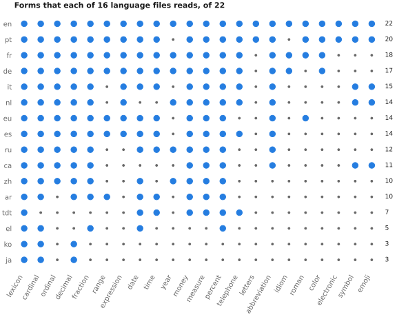

# Languages at a glance

<!-- agent-hint
covers: which forms each language file reads, and how many test rows each file holds and how many cite a source.
source: text2spoken/lang/, text2spoken/core/language.py:supports, tests/data/*.tsv
generated: no, except docs/img/forms-per-language.svg and docs/img/rows-per-language.svg, which docs/img/plot_forms_per_language.py and docs/img/plot_rows_per_language.py write
verify: `python scripts/check_doc_page.py docs/coverage.md`
see: how-it-reads.md, development.md, languages/en.md
-->

This page shows which forms each language file reads, and how well the test rows of each file are sourced. Use it to see where a language stops, before you read its page.

## Forms that each language reads

Each language file reads the forms that its recognizers and verbalizers offer. `supports(lang).forms` lists them. A form that a file does not offer stays as written:

```python
>>> from text2spoken import normalize, supports
>>> len(supports("en-GB").forms), len(supports("ja").forms)
(22, 3)
>>> sorted(form.value for form in supports("ja").forms)
['cardinal', 'decimal', 'lexicon']
>>> normalize("5 kg and 3.5", "ja")
'5 kg and 三点五'
```

<picture>
  <source media="(prefers-color-scheme: dark)" srcset="img/forms-per-language-dark.svg">
  
</picture>

`img/plot_forms_per_language.py` makes this figure from `supports(code).forms`.

*Figure: the forms that each language file reads. A large dot means the file reads the form. English reads the most forms, Hindi, Japanese and Korean read three, and Bengali reads two. The form `IDENTIFIER` has a column in no file, because no language file reads it, so the figure leaves it out.*

English reads all 22 forms that any file reads. Hindi, Japanese and Korean read cardinals, decimals and the lexicon. Bengali reads cardinals and the lexicon. A language page names the forms of its file in the sentence "The file reads ...". [How it reads text](how-it-reads.md#the-forms) lists every form and its default.

A tag with no language file reads cardinals and decimals only. [How it reads text](how-it-reads.md#a-language-with-no-file) gives the rules.

## How well the rows are sourced

Each language file has a file of test rows in `tests/data`. Each row holds a written text and the spoken text that a cited rule, a calculation by hand or a native speaker gives, never a run of the code. A row whose reading no source holds is marked `silver` in its `source` column. [Development](development.md#the-row-files) describes the columns.

<picture>
  <source media="(prefers-color-scheme: dark)" srcset="img/rows-per-language-dark.svg">
  
</picture>

`img/plot_rows_per_language.py` makes this figure from `tests/data`.

*Figure: the test rows of each language file, in blue where the row cites a source and in orange where it is marked silver. Portuguese, English and French hold the most rows, and nine files hold only cited rows.*

Nine files hold silver rows: those of Bengali, Dutch, German, Hindi, Italian, Portuguese, Russian, Spanish and Tetun Dili. A silver row is a reading that no source states.

The figures come from the files that the page names. `python scripts/docs_figures.py` writes them again, and `python scripts/docs_figures.py --check` exits 1 when a committed figure is out of date.

---
[← Addresses, letters and emoji](addresses-letters-and-emoji.md) · [Home](index.md) · [How it works →](how-it-works.md)
