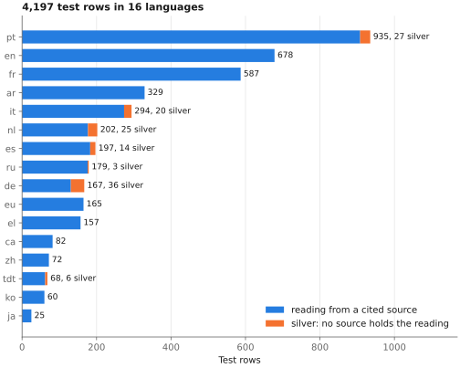

# Languages at a glance

<!-- agent-hint
covers: which forms each language file reads, and how many test rows each file holds and how many cite a source.
source: text2spoken/lang/, text2spoken/core/language.py:supports, tests/data/*.tsv
generated: no, except docs/img/forms-per-language.svg and docs/img/rows-per-language.svg, which docs/img/plot_forms_per_language.py and docs/img/plot_rows_per_language.py write
verify: `python scripts/check_doc_page.py docs/coverage.md`
see: how-it-reads.md, development.md, languages/en.md
-->

This page shows which forms each language file reads, and how well the test rows of each file are sourced. Use it to see where a language stops, before you read its page.

The leader languages come first in each table and figure, in this order: `pt-PT`, `pt-BR`, `es-CO`, `fr-FR`, `it-IT`, `de-DE`, `nl-NL`, `da-DK`, `kab`, `hi-IN`, `bn-IN` and `mwr`. The other languages follow.

## Forms that each language reads

Each language file reads the forms that its recognizers and verbalizers offer. `supports(lang).forms` lists them. A form that a file does not offer stays as written:

```python
>>> from text2spoken import normalize, supports
>>> len(supports("en-GB").forms), len(supports("ja").forms)
(22, 3)
>>> sorted(form.value for form in supports("ja").forms)
['cardinal', 'decimal', 'lexicon']
>>> normalize("5 kg and 3.5", "ja")
'5 kg and 三点五'
```

<picture>
  <source media="(prefers-color-scheme: dark)" srcset="img/forms-per-language-dark.svg">
  
</picture>

`img/plot_forms_per_language.py` makes this figure from `supports(code).forms`.

*Figure: the forms that each language file reads. A large dot means the file reads the form. English reads the most forms, and Japanese and Korean read three. The form `IDENTIFIER` has a column in no file, because no language file reads it, so the figure leaves it out.*

English reads all 22 forms that any file reads. Japanese and Korean read cardinals, decimals and the lexicon. A language page names the forms of its file in the sentence "The file reads ...". [How it reads text](how-it-reads.md#the-forms) lists every form and its default.

A tag with no language file reads only the forms that its number words give. When `ovos-number-parser` has a module for the language, or CLDR has spell-out rules for it, the tag reads cardinal numbers, and decimals when that owner reads them. A language with neither reads only the lexicon. [How it reads text](how-it-reads.md#a-language-with-no-file) gives the rules.

Five leader languages have no language file. `da-DK` and `hi-IN` read cardinals and decimals, `kab` reads cardinals only, and `bn-IN` and `mwr` read only the lexicon. `scripts/docs_figures.py` writes this table from `supports(tag).forms`:

<!-- no-file-table -->
| Tag | Forms |
| --- | --- |
| `da-DK` | `cardinal`, `decimal`, `lexicon` |
| `kab` | `cardinal`, `lexicon` |
| `hi-IN` | `cardinal`, `decimal`, `lexicon` |
| `bn-IN` | `lexicon` |
| `mwr` | `lexicon` |
<!-- /no-file-table -->

## Forms that differ by region

The leader regions read most forms in the same way as the other regions of their language. These forms differ:

- `pt-PT` and `pt-BR`: `pt-BR` uses the short scale, so the word for `10^9` is *bilhão* ([pt.md, line 113](languages/pt.md#varieties)). The group mark is the space in `pt-PT` and the full stop in `pt-BR` ([pt.md, line 96](languages/pt.md#what-it-reads)). In `pt-PT` a unit after any decimal takes the plural, and in `pt-BR` a decimal below 2 takes the singular ([pt.md, line 223](languages/pt.md#limits)). After `artigo`, `pt-BR` reads a Roman numeral as an ordinal only up to nine ([pt.md, line 138](languages/pt.md#roman-numerals)).
- `es-CO`: the decimal mark is the comma ([es.md, line 42](languages/es.md#varieties)). `Cuesta $5.` stays as written, because `$` can be a peso or a dollar there ([es.md, line 90](languages/es.md#limits)).
- `fr-FR`: `fr-FR` is the default variety. It says *soixante-dix*, *quatre-vingts* and *quatre-vingt-dix*, where `fr-BE` and `fr-CH` say *septante* and *nonante* ([fr.md, line 122](languages/fr.md#varieties)).

## How well the rows are sourced

Each language file has a file of test rows in `tests/data`. Each row holds a written text and the spoken text that a cited rule, a calculation by hand or a native speaker gives, never a run of the code. A row whose reading no source holds is marked `silver` in its `source` column. [Development](development.md#the-row-files) describes the columns.

<picture>
  <source media="(prefers-color-scheme: dark)" srcset="img/rows-per-language-dark.svg">
  
</picture>

`img/plot_rows_per_language.py` makes this figure from `tests/data`.

*Figure: the test rows of each language file, in blue where the row cites a source and in orange where it is marked silver. Portuguese, English and French hold the most rows, and nine files hold only cited rows.*

Seven files hold silver rows: those of Dutch, German, Italian, Portuguese, Russian, Spanish and Tetun Dili. A silver row is a reading that no source states.

The figures come from the files that the page names. `python scripts/docs_figures.py` writes them again, and `python scripts/docs_figures.py --check` exits 1 when a committed figure is out of date.

---
[← Addresses, letters and emoji](addresses-letters-and-emoji.md) · [Home](index.md) · [How it works →](how-it-works.md)
