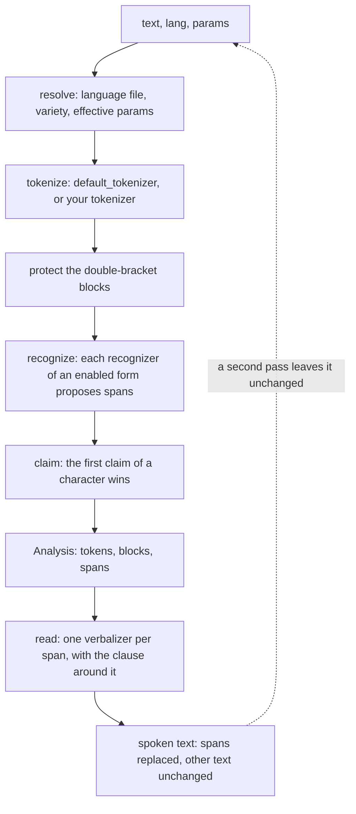
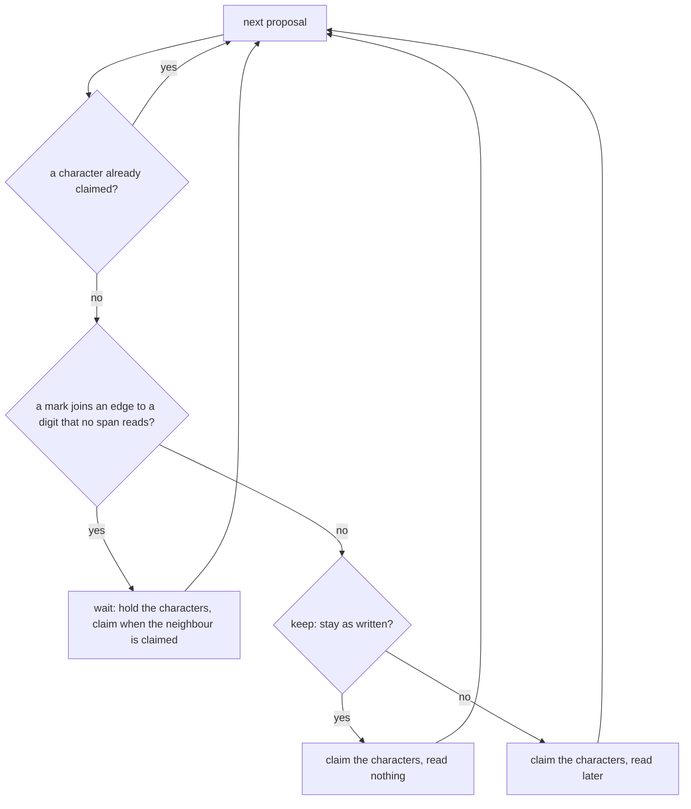
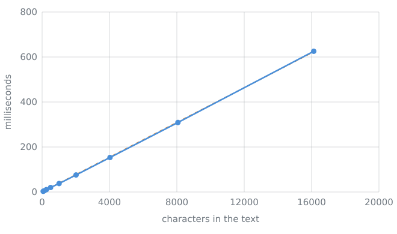

# How it works

<!-- agent-hint
covers: the stages of a normalize call, how overlapping forms are resolved, and the cost of a call.
source: text2spoken/core/pipeline.py:analyze, text2spoken/core/spans.py:classify, text2spoken/core/spans.py:render, text2spoken/core/language.py:_registry, docs/figures/timing.json
generated: no, except docs/figures/time-by-length.svg, which scripts/docs_figures.py writes
verify: `python scripts/check_doc_page.py docs/how-it-works.md`
see: api.md, adding-a-language.md, how-it-reads.md
-->

This page follows one text through `normalize`: the tokens, the spans that the recognizers find, the claim step that settles overlaps, and the verbalizers that write the words. It ends with the cost of a call.

## The stages

`normalize(text, lang, params)` is `render(analyze(text, lang, params))`. `analyze` finds the spans and reads nothing. `render` reads each span and puts the words in its place.



*Figure: the stages of a `normalize` call. The dashed arrow is a property of the output, not a stage: `normalize` on its own output returns the same text.*

The stages in order:

1. **Resolve.** The tag picks the language file and the variety. The params that are `None` take the defaults of the variety, as `effective_params` shows.
2. **Tokenize.** The default tokenizer splits the text into words and marks. A tokenizer that you give replaces it. The text between `[[` and `]]` is a block, and no span enters it.
3. **Recognize.** Each recognizer of the language file whose form is in `params.forms` looks at the text and proposes spans.
4. **Claim.** The proposals compete for characters. A character belongs to one span at most.
5. **Read.** The verbalizer of each span writes its words. It sees the words around the span, up to the end of the clause. Text outside the spans stays as written.

The first call for any tag imports every language file in `text2spoken.lang` once. `import text2spoken` imports none.

## One text, step by step

`analyze` shows what the first four stages found:

```python
>>> from text2spoken import analyze, render
>>> analysis = analyze("Dr Smith paid £3.50 for 2 tickets on 14 March 2024.", "en-GB")
>>> [token.text for token in analysis.tokens][:6]
['Dr', 'Smith', 'paid', '£', '3.50', 'for']
>>> [(analysis.text[span.start:span.end], span.form.value, span.recognizer) for span in analysis.spans]
[('Dr', 'abbreviation', 'abbreviation'), ('£3.50', 'money', 'money'), ('2', 'cardinal', 'cardinal'), ('14 March 2024', 'date', 'date_named')]
```

The money span holds the sign and the amount, so the `3.50` is no decimal. The date span holds the day, the month and the year, so none of the three numbers is a cardinal. `render` turns each span into words:

```python
>>> render(analysis)
'Doctor Smith paid three pounds and fifty pence for two tickets on the fourteenth of March twenty twenty-four.'
```

## Overlaps: the claim step

Several recognizers can propose the same characters. In `14 March 2024`, a date recognizer proposes the whole date and the cardinal recognizer proposes `14` and `2024`. The language file lists its recognizers in an order, and the proposals of an earlier recognizer claim first. In `text2spoken/lang/en.py` the named-date recognizer comes before the cardinal recognizer, so the date claims all three numbers. A later proposal that needs a character that is already claimed is dropped. Here the date claims `12/03/2024` before the fraction recognizer reads the `3/4` that follows it:

```python
>>> analysis = analyze("Pay on 12/03/2024 or 3/4.", "en-GB")
>>> [(analysis.text[span.start:span.end], span.form.value) for span in analysis.spans]
[('12/03/2024', 'date'), ('3/4', 'fraction')]
```

The loop of the claim step takes the proposals in that order:



*Figure: the loop of the claim step. A proposal that a mark joins to an unread digit waits, so that a run of digits is not read in pieces.*

A span that a mark joins to a digit run that no span reads waits. When a span claims a neighbour, the waiting span runs the check again. A digit run that no span reads whole stays as written, and a second pass gives the same result. A span with `keep=True` claims its characters and leaves them as written, which is how the library keeps a form that it cannot read for sure. [How it reads text](how-it-reads.md) gives the rules in terms of the forms.

## Read: the verbalizer

A verbalizer receives the span and its context: the words before and after it in the same clause, and the hint of the caller if there is one. It returns words. When it cannot read a span, it declines. The default mode then keeps the written text and logs a WARNING on the `text2spoken` logger. Strict mode raises `UnreadFormError`:

```python
>>> from text2spoken import NormalizationParams, normalize
>>> normalize("The time was 1:23:45.", "en-GB")
'The time was 1:23:45.'
>>> normalize("The time was 1:23:45.", "en-GB", NormalizationParams(strict=True))
Traceback (most recent call last):
    ...
text2spoken.errors.UnreadFormError: ...
```

A `say_as` argument moves the form that it names to the front of the claim step. [API, say_as](api.md#say_as) gives the forms and their formats.

## A second pass

The output of `normalize` holds no written form that `normalize` reads. So a second call on the output returns it unchanged:

```python
>>> once = normalize("Meet at 14:30 for 2 hours.", "en-GB")
>>> once
'Meet at two thirty PM for two hours.'
>>> normalize(once, "en-GB") == once
True
```

The test rows check this for every row. The known exceptions are on the pages of the forms and the languages that have them.

## Cost

The time of a call grows in proportion to the length of the text. The figure shows one machine and one text: a sentence with an abbreviation, a sum of money, a number, a date and a time, repeated up to 16,128 characters. The time per character stays the same from 1,000 characters to the largest text.



*Figure: time of `normalize` against the length of the text, en-GB, one machine. Read the straight line, not the milliseconds: doubling the text doubles the time. The numbers are in `docs/figures/timing.json`, and `python scripts/docs_figures.py --measure` runs the measurement again on your machine.*

Other shapes of text, such as plain words, groups of digits, phone numbers, dates, capital words and web addresses, give the same straight line, with a different cost for each character. The cost per character depends on the form that the text holds.

The first call for a language is slower than the later calls, because the library imports the language files and keeps what it reads. It makes no network request and loads no model. Its number and date words come from Python packages that the install brings, and from data files in the wheel.

[Adding a language](adding-a-language.md) shows how a language file declares its recognizers, in the order that the claim step uses.

---
[← Languages at a glance](coverage.md) · [Home](index.md) · [API →](api.md)
