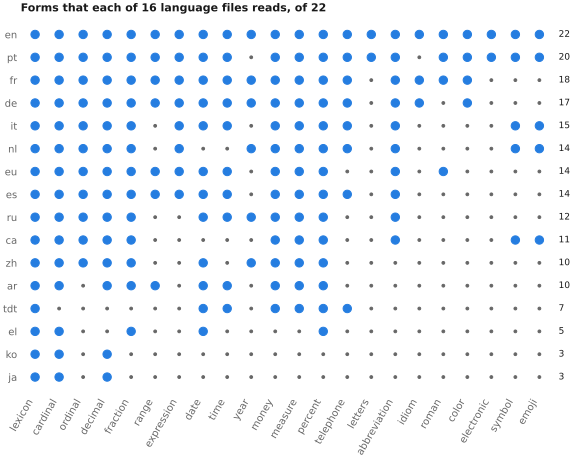

# text2spoken documentation

<!-- agent-hint
covers: the list of every docs page in reading order.
source: docs/, tests/test_docs_examples.py:MINIMUM
generated: no
verify: `python scripts/check_doc_page.py docs/index.md`
see: quickstart.md
-->

text2spoken rewrites written forms, such as `12/03/2024`, `£3.50` or `Dr`, into the words that a speaker says.

<picture>
  <source media="(prefers-color-scheme: dark)" srcset="img/forms-per-language-dark.svg">
  
</picture>

`img/plot_forms_per_language.py` makes this figure from `supports(code).forms`.

## Quickstart

```bash
uv pip install --prerelease=allow text2spoken
```

```python
>>> from text2spoken import normalize
>>> normalize("Dr Smith paid £3.50 for 2 tickets on 14 March 2024.", "en-GB")
'Doctor Smith paid three pounds and fifty pence for two tickets on the fourteenth of March twenty twenty-four.'
>>> normalize("Meet on 03/04/2025 at 7:30 pm.", "en-US")
'Meet on March fourth twenty twenty-five at seven thirty PM.'
```

## Pages

Find the page for your question below. The pages are in reading order, from a first call to the contract of a language file.

| Question | Page |
| --- | --- |
| How do I install it and get spoken text? | [Quickstart](quickstart.md) |
| How do I turn a form off or on, pick a variety, or add my own words? | [Usage](usage.md) |
| Why did a text read this way, and what stays as written? | [How it reads text](how-it-reads.md) |
| How does it read numbers? | [Numbers](numbers.md) |
| How does it read dates, times and years? | [Dates and times](dates-and-times.md) |
| How does it read money, units, percentages and symbols? | [Money, units and symbols](money-units-and-symbols.md) |
| How does it read addresses, capital letters, abbreviations and emoji? | [Addresses, letters and emoji](addresses-letters-and-emoji.md) |
| Which forms does each language read, and how well are its rows sourced? | [Languages at a glance](coverage.md) |
| How does a text go through the library, and what does a call cost? | [How it works](how-it-works.md) |
| What does each function, param and field do? | [API](api.md) |
| What does each error and warning mean? | [Errors and warnings](errors.md) |
| How do I add my language? | [Adding a language](adding-a-language.md) |
| How do I run the tests, write the row files, or release? | [Development](development.md) |

## Languages

Each language page gives what the language reads, its varieties and the codes that it serves, its options, its sources and its limits.

| Language | Page |
| --- | --- |
| Arabic | [ar](languages/ar.md) |
| Catalan | [ca](languages/ca.md) |
| German | [de](languages/de.md) |
| Greek | [el](languages/el.md) |
| English | [en](languages/en.md) |
| Spanish | [es](languages/es.md) |
| Basque | [eu](languages/eu.md) |
| French | [fr](languages/fr.md) |
| Hindi | [hi](languages/hi.md) |
| Italian | [it](languages/it.md) |
| Japanese | [ja](languages/ja.md) |
| Korean | [ko](languages/ko.md) |
| Dutch | [nl](languages/nl.md) |
| Portuguese | [pt](languages/pt.md) |
| Russian | [ru](languages/ru.md) |
| Tetun Dili | [tdt](languages/tdt.md) |
| Chinese | [zh](languages/zh.md) |

The language pages come after [Errors and warnings](errors.md) in the reading order.
